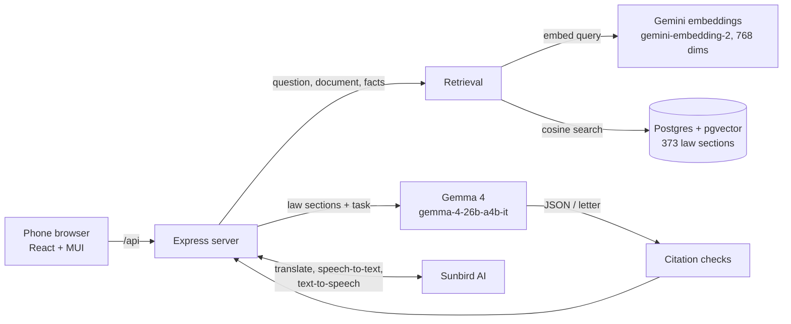

# Eddembe -Legal Assistant

**Eddembe** (Luganda for *rights* or *freedom*) is a Luganda-first legal rights assistant for Uganda,
built on **Gemma 4** through the Gemini API.

**Live demo:** https://eddembe-legal-assistant-x3nd.vercel.app

> Eddembe gives legal information, not legal advice.

## The problem

Most Ugandans cannot afford a lawyer, and most laws are written in formal English. A tenant who gets an
eviction notice, a worker whose pay is withheld, or a family in a land dispute often does not know their
rights or how to respond in writing.

Eddembe lets them:

1. **Ask about their rights** by text or voice, in English or Luganda, and get a plain answer that cites the
   exact section of Ugandan law.
2. **Scan a document** (photo, PDF or Word file) such as an eviction notice or job contract, and get an
   explanation with red flags, missing items, and the law that applies.
3. **Write a letter** (reply to a landlord, complaint to an employer, Access to Information request) that
   cites only real, checked law sections.

## How Gemma 4 is used

Gemma 4 (`gemma-4-26b-a4b-it`) does all of the reasoning. Every call goes through
[`server/src/services/gemma.ts`](server/src/services/gemma.ts).

| Feature | What Gemma does |
|---|---|
| Ask | Answers from the retrieved law sections only, citing the law and section for every claim, in JSON. |
| Scan (photo) | Reads the image directly (multimodal input): transcribes it, explains it, lists red flags and missing items. |
| Scan (PDF/Word) | Does the same from the text we extract from the file. |
| Scan, second step | Links each red flag to the law sections retrieved for it. |
| Letter | Drafts a polite, firm letter that cites only the retrieved sections. |

Gemma's answers are checked, not trusted blindly:

- Replies are validated with zod. Broken JSON gets one "fix this JSON" retry.
- Every citation must match a section that was actually retrieved. A made-up quote is replaced with the real law text.
- In letters, every "Section N of <law>" is checked against that law. If one is unknown, Gemma redrafts once.
- Where the Employment (Amendment) Act, 2026 changes a section of the Employment Act, the amendment is
  retrieved with it and Gemma is told the amendment wins.

No model was trained or fine-tuned. Eddembe uses retrieval-augmented generation: the law text lives in the
database and Gemma reasons over it, so citations stay exact and new laws can be added without retraining.

## Architecture



**Ask flow**

1. Luganda questions are translated to English with Sunbird.
2. The question is embedded and the 5 closest law sections are found. Any 2026 amendments that change
   those sections are added.
3. Gemma answers from those sections, in JSON.
4. Citations are checked against the retrieved sections.
5. The answer is translated back to Luganda. Law names and quoted law text stay in official English.

## Laws covered

| Law | Sections |
|---|---|
| Constitution of the Republic of Uganda, 1995, Chapter Four (human rights) | 41 |
| Landlord and Tenant Act, 2022 | 52 |
| Employment Act, Cap. 226 | 102 |
| Employment (Amendment) Act, 2026 | 33 |
| Land Act, Cap. 236 | 96 |
| Access to Information Act, 2005 | 49 |

Sources and licences are listed in [data/laws/README.md](data/laws/README.md).

## Luganda

- The whole interface switches between English and Luganda, including answers, scan results and letters.
- Interface text is translated once by Sunbird into [web/src/i18n/lg.json](web/src/i18n/lg.json)
  (`npm run translate-ui`). Corrections for short labels live in
  [lg.overrides.json](web/src/i18n/lg.overrides.json).
- Before translation, words Sunbird often gets wrong are reworded into clearer English
  (for example "employer" becomes "boss at work", so it is not translated as "worker").

## Run it locally

Needs Node.js 20+, Docker, and `pdftotext` (poppler-utils) if you re-convert the law PDFs.

```bash
cp .env.example .env              # add GEMINI_API_KEY and SUNBIRD_API_KEY
docker-compose up -d              # Postgres with pgvector on port 5433

cd server
npm install
npm run convert-laws              # data/laws/pdf/*.pdf -> data/laws/*.txt (already done)
npm run ingest                    # split into sections, embed, store (about 4 minutes)
npm run dev                       # API on http://localhost:4100

cd ../web
npm install
npm run dev                       # app on http://localhost:5180
```

Sample documents for rehearsing the demo are in [samples/](samples/). They are all fake, marked SAMPLE, and
use made-up names.

## Deployment

The app runs on Vercel as one project with Root Directory `server`:

- the Express API becomes one Vercel Function (up to 300 seconds per request);
- the web app is built into `server/web-dist` and served by the same function;
- the database is Neon Postgres with pgvector.

See [server/vercel.json](server/vercel.json).

## Limitations

- Covers only six laws. Questions outside them get a low-confidence answer pointing to legal aid.
- Luganda quality depends on Sunbird's translation. Law names and quotes stay in English.
- Answers can take 10 to 90 seconds, longer when the Gemma API is busy.
- Scanned PDFs have no text layer; users are asked to take a photo instead.
- Uploads over about 4.5 MB are refused by the hosting platform.
- Eddembe gives legal information, not legal advice.

## License

MIT © 2026 Nuwahereza Peter. The law texts in `data/laws/` keep their own licences.
